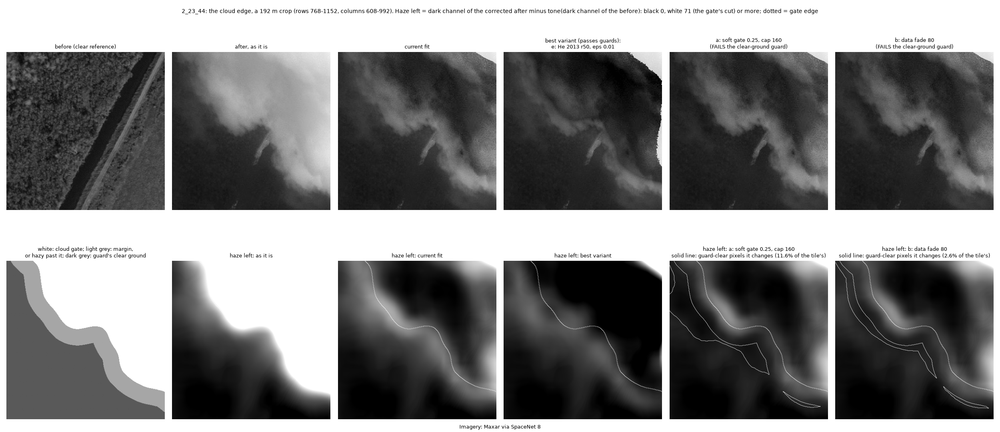
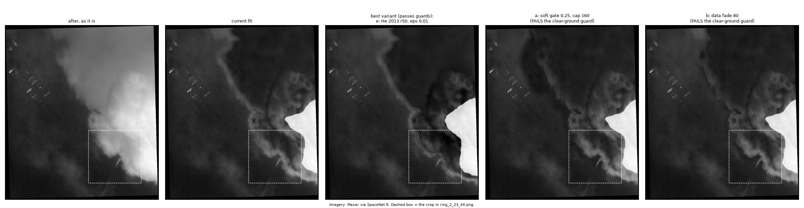
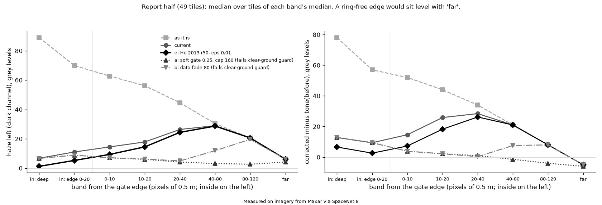

# 09: The ring around the corrected cloud (2026-10-25; EXPLORATORY, development data only, real cloud, label-free)

Our own measurements, not literature.

**Why:** Justin (2026-10-25): "I am seeing a slight ring around the cloud that did not fully get removed, working some
additional to create this smoother transition may help our results". Also: "when we detect a cloud in any image we will
try to see through it as if it is a step in preprocessing", and "hold off on synthetic cloud generation until we can
reliably see through real clouds". So everything here is on real cloud, and no synthetic haze is used.

**Setup:**
- **Code:** GeoAI-Roads `85d9995` adds the new module `ClaudeFunctions/sn8_cloudedge.py`. It holds the measures,
  guards, arms and grids, and it was committed before any arm was run. `1532e9a` adds arm (e) (see "Departures").
  `sn8_refhaze.py` and every other existing module are unchanged.
- **Driver:** `evidence/pilot_scripts/cloud_edge/cloud_edge.py`, run in stages (`tiles`, `arms`, `arms_e`, `select`,
  `report`, `figures`), each with its own `.log`.
  - Run times: tiles 292 s, arms a–d 706 s, arm e 128 s.
  - Per-tile tables: `arms_tiles.csv`, `arms_e_tiles.csv`. Selection: `chosen.json`. All numbers: `numbers.json`.
  - Post-hoc scripts, marked below: `posthoc_choose_bands.py`, `posthoc_guard_check.py`, `posthoc_detail.py`.
- **Check:** on every tile, the driver's "current" arm reproduces `dark_reference_dehaze` exactly (largest difference
  < 0.001 grey levels, the same opaque pixels; the run asserts it).
- **Data:**
  - The tiles the tile rule scores: `touched_roads(include_cloudy=True)`, rows not `cloudy`. That is 200 training +
    validation tiles; `set(roads.split) <= {"train", "val"}` is asserted, and the ids are checked against
    `split_tables()`'s train and val.
  - Kept: the **99** with a non-empty `cloud_gate`.
  - Split into two halves by tile id (SHA-256 order of the id, alternately): **choose** (50 tiles, settings picked here)
    and **report** (49 tiles, reported only). 2_23_44 is in the choose half.
- **Not read:** no test, north negative, Germany or Louisiana-West tile was opened, and `allow_held_out` was never
  passed. No flood label was used: of the road table, only `tile_id`, `split` and `cloudy` were read. Greyscale only.
- **Status:** nothing is promoted. `sn8_refhaze` is unchanged.

## In short
**Evidence (report half unless said):**
1. **What causes the ring.** The numbers are over all 99 tiles, medians over tiles, as excess over far clear ground:
   - **The cloud's fringe is wider than the gate + margin.** In the uncorrected after image the haze is still there
     40–80 px (20–40 m) past the gate: dark-channel excess 23.5, grey excess 25. At 80–120 px it is 13.9 and 14. The
     excess exceeds 2 on 94 and 92 of the 99 tiles. The current fit removes 6% and 0% of it there.
   - **Inside the 40 px margin, the linear fade removes only part of the haze.** In the dark channel it removes 88%,
     76% and 49% at 0–10, 10–20 and 20–40 px. In grey levels it removes 61%, 40% and 16%. The fade's own share at the
     band middles is 88%, 62% and 25%.
   - **So the current fit's ring sits 10–80 px past the gate edge.** It peaks there at about 26–33 grey levels brighter
     than far clear ground (report half).
   - **It also draws an edge that the uncorrected image does not have** (post-hoc). The seam profile peaks 0–8 px
     outside the gate edge, at 4.6–4.8 times the far-ground gradient ratio, against 2.1–2.2 uncorrected.
   - **The minimum-filter edge effect (cause 3) is small.** Haze left just inside the gate edge is 9.1, against 6.0
     deep inside. In grey levels the inner edge is *less* bright than deep inside (9.6 against 14.6). The arms aimed at
     it (c, d, e) move the ring score by at most 2–5.
2. **The best variant under the pre-set guards is (e), He, Sun & Tang 2013's recipe with r 50 and ε 0.01.**
   - Ring score 17.3 → 15.0: 35 of 49 tiles better, 14 worse, sign test p = 0.004; mean −2.9 (95% CI −4.3 to −1.6).
   - Grey ring score 27.9 → 22.8: 44 of 49 better, p = 8e-9; mean −3.4 (−4.4 to −2.5).
   - Clear ground changed 0%. Detail kept 0.95 of the current fit (the guard's limit). Seam 1.03 of current. Texture
     copied −0.005.
   - **But it does not remove the visible ring.** It works inside the gate and in the first 20 px. At 40–80 px it
     leaves 28.7 against the current fit's 29.0.
   - It makes more of the gate opaque: mean 4.2% → 5.4% of the gate, more on 18 tiles and less on 9 (2_23_44: 11.8% →
     15.5%).
3. **The two arms that do remove the ring fail the clear-ground guard.**
   - (a), the soft gate (0.25, cap 160): ring score 17.3 → 5.4 (44 of 49 better, p = 8e-9; mean −10.3, CI −13.1 to
     −7.3).
   - (b), the data fade (80): ring score 17.3 → 6.3 (43 of 49, p = 6e-8; mean −9.1, CI −11.7 to −6.3).
   - Both also bring the grey ring down by 12–13 grey levels.
   - They change 13.5% and 4.7% of the guard's "clear ground" (mean over tiles; over 1% on 45 and 38 tiles). For (a) at
     0.5, cap 80 it is 2.7%.
   - (b) and the cap-80 settings change no far ground (over 60 m from the gate). (a) at cap 160 changes 7.2% of it.
4. **The guard's "clear ground" next to the cloud is not clear** (post-hoc, choose half). Of the pixels beyond the
   margin with tone-matched dark rise ≤ 36 (what the guard calls clear):
   - at 40–80 px from the gate the median rise is 22.4 and the grey residual +12.5;
   - at 80–120 px, 15.9 and +4.0;
   - at 120–160 px, 11.4 and 0.0;
   - beyond 160 px, 3.7 and −7.0.
   - So the near-cloud "clear" ground is up to 19.5 grey levels brighter than far clear ground, and the guard and the
     ring conflict: removing the ring means changing this band.
5. **The other arms:**
   - (c), guided by the BEFORE image: no ring gain (20 better, 29 worse, p = 0.25). It copies the before image's fine
     detail into the corrected after: texture copied 0.06 at r 20, ε 1e-4, and 0.11 at r 60, ε 1e-4, which fails the
     0.1 guard.
   - (d), the 11 px window: ring −3.1 (median), but it adds a seam (1.26 of current) and fails.
   - No combination was built: no spread arm passed the guards.

**Inference:**
- The ring is mostly the cloud's thin outer fringe, which lies beyond where the current fit stops correcting, plus the
  linear fade's partial removal inside the margin. It is not mainly the dark channel's block or halo effect.
- A t refinement (c, d, e) cannot fix it, because the fix has to reach pixels that the gate, the margin and the
  clear-ground guard all treat as clear.

**Recommendation:**
- **Keep the current fade for now.** Do not move (e) in expecting the ring to go: on the pictures (e) barely changes it.
- **(e) is a defensible t refinement.** It is the dark channel's authors' own recipe (evidence 10), and it passed every
  guard on both halves, with a small, significant gain. Its cost, more opaque gate, should be checked on the road
  decisions before it moves into `sn8_refhaze`.
- **Only (a) or (b) removes the ring.** Either one needs a decision from Justin on the clear-ground ≤ 1% rule near
  clouds. If he accepts that the band next to a cloud is haze (point 4; Zhu et al. 2015 and the operational masks
  agree, evidence 10), the candidates are:
  - (b) data fade 80;
  - (a) soft gate 0.5, cap 80.
  - Both change no ground beyond 60 m from the gate. Either would replace the current fade. They should be tested once
    more under the new rule (see "What to do next").

## The measure (label-free, on real cloud)
- **Distance bands:** bands of signed distance from the gate edge, in pixels of 0.5 m.
  - Inside: "deep" (over 20 px in) and "edge" (0–20 px in).
  - Outside: 0–10, 10–20, 20–40, 40–80 and 80–120 px.
  - Far clear ground: over 120 px (60 m).
  - No-data does not count as an edge. The current fit's opaque pixels are left out of every band, so all arms are
    scored on the same pixels.
- **Residual haze (main measure):** the dark channel of the corrected after image minus tone(dark channel of the
  before image).
  - This is the quantity t is built from, so it is 0 where the haze is gone.
  - Per band: the median, and the share of pixels above half the dark-rise cut (71 / 2 = 36).
  - **Ring score:** the mean, over the four bands 0–80 px, of |band median − far-ground median|. 0 means the edge looks
    like far clear ground.
  - It is partly circular for (a) and (b), which set t from this quantity in the fringe. Its 41 px window also blurs
    the profile over about ±40 px.
- **Grey residual (second measure):** corrected − tone(before), pixel by pixel, scored the same way as the **grey ring
  score**. It does not pass through the dark channel, so it resolves narrow rings and is not what any arm sets t from.
- **Guards (fixed before the run, in `sn8_cloudedge`):**
  - **Clear ground changed:** of the pixels over 40 px from the gate whose tone-matched dark rise is ≤ 36, the share
    with t < 0.95 (evidence 07's rule). The mean over tiles must be ≤ 1%.
  - **Detail kept inside the gate:** median local contrast (`local_contrast`), at least 0.95 × the current fit's.
  - **Seam index:** the gradient of the corrected image smoothed at σ 4 px, divided by the before image's, ring by ring
    (4 px rings from −8 to 160 px around the gate edge, and ±20 px around where the correction stops), all over the same
    ratio on far ground. Take the maximum; it must be at most 1.05 × the current fit's.
  - **Texture copied:** the correlation of the arm's change, relative to the current fit, with the before image's fine
    detail inside the gate. It must be ≤ 0.1.

## The arms (all faded or tapered, so nothing changes far from the gate)
| Arm | What changes | Settings tried |
|---|---|---|
| current | t = (A − dark after) / (A − tone(dark before)) in the gate, × a linear fade over 40 px | – |
| (a) soft gate | pixels with tone-matched rise > low × 71, **connected to a gate blob** (not evidence 07's global grown gate), within cap px of it, take the full data t; then the 40 px fade | low 0.25, 0.5 × cap 80, 160 px |
| (b) data fade | past the gate, the data t clipped to [t at the nearest gate pixel, 1], at full strength over the first half of the margin, then tapering | margin 40, 80, 120 px |
| (c) before-guided t | the guided filter on t, guided by the BEFORE image, then the current fade | r 20, 60 × ε 1e-4, 1e-2 |
| (d) small window | t from an 11 or 21 px dark channel within 40 px of the edge (inside and out), then the current fade | window 11, 21 |
| (e) He 2013 recipe | each date's dark channel = 41 px min then 41 px max (an opening, no box blur); t as now; the guided filter on t guided by the hazy AFTER image; then the current fade | r 20 (He's), 50 (scaled to our tiles) × ε 1e-3 (He's), 1e-2 |

**Rule for choosing a setting (fixed before the run):** on the choose half, the lowest median ring score among the
settings that pass every guard. If no setting passes, the arm is reported as failing, with its lowest-score setting.

## Results

### Choose half (50 tiles): picking the settings
| Arm (best setting) | Ring score | Grey ring | Clear ground changed (mean; tiles > 1%) | Detail kept | Seam vs current | Texture copied | Passes |
|---|---|---|---|---|---|---|---|
| as it is | 35.5 | 40.7 | – | 0.50 | 0.59 | – | – |
| current | 12.4 | 27.6 | 0% | 1 | 1 | 0 | yes |
| (a) 0.25, cap 160 | 4.8 | 12.7 | 14.8% (48) | 1.00 | 0.79 | 0.001 | **no** (clear ground) |
| (a) 0.5, cap 80 | 7.6 | 13.6 | 3.1% (36) | 1.00 | 0.91 | 0.000 | no (clear ground) |
| (b) 80 | 6.3 | 14.5 | 4.1% (42) | 1.00 | 0.87 | 0.001 | **no** (clear ground) |
| (b) 40 | 10.0 | 21.6 | 0% | 1.00 | 1.30 | 0.001 | no (seam) |
| (c) r 20, ε 1e-4 | 12.7 | 27.4 | 0% | 1.00 | 0.96 | 0.057 | yes |
| (c) r 60, ε 1e-4 | 12.6 | 26.7 | 0% | 0.99 | 0.93 | **0.113** | no (texture copied) |
| (d) 11 | 10.8 | 25.6 | 0% | 1.06 | 1.17 | 0.020 | no (seam) |
| (e) r 20, ε 1e-2 | 9.9 | 24.7 | 0% | 1.03 | 1.09 | −0.002 | no (seam) |
| (e) r 50, ε 1e-3 | 12.5 | 25.0 | 0% | **0.83** | 0.99 | −0.004 | no (detail) |
| **(e) r 50, ε 1e-2** | **11.3** | 25.2 | 0% | 0.96 | 1.01 | −0.002 | **yes → best** |

- **Chosen per arm:** (a) 0.25, cap 160 (fails); (b) 80 (fails); (c) r 20, ε 1e-4 (passes, but its ring score is above
  the current fit's); (d) 11 (fails); (e) r 50, ε 1e-2 (passes).
- **Best variant:** (e) r 50, ε 1e-2.
- **Combination:** not built. It needed a passing (a) or (b).
- **Detail at ε 1e-3:** (e) at r 50, ε 1e-3 loses detail (0.83). This repeats the earlier after-guided result (0.68 at
  ε 1e-4); He's larger ε keeps it.

### Report half (49 tiles): the held-out numbers
| Arm | Ring score | Grey ring | Clear ground changed (mean; tiles > 1%) | Far ground changed | Detail kept | Seam vs current | Texture copied | Passes |
|---|---|---|---|---|---|---|---|---|
| as it is | 39.2 | 42.8 | – | – | 0.50 | 0.59 | – | – |
| current | 17.3 | 27.9 | 0% | 0% | 1 | 1 | 0 | yes |
| **(e) r 50, ε 1e-2 (best)** | **15.0** | **22.8** | 0% | 0% | 0.95 | 1.03 | −0.005 | **yes** |
| (a) 0.25, cap 160 | 5.4 | 13.8 | 13.5% (45) | 7.2% | 1.00 | 0.74 | 0.001 | no |
| (b) 80 | 6.3 | 16.4 | 4.7% (38) | 0% | 1.00 | 0.86 | 0.001 | no |
| (c) r 20, ε 1e-4 | 17.1 | 27.9 | 0% | 0% | 1.01 | 0.94 | 0.060 | yes |
| (d) 11 | 12.1 | 23.0 | 0% | 0% | 1.05 | 1.26 | 0.031 | no (seam) |

**Paired against the current fit, report half (per tile; sign test; mean with 95% CI from resampling tiles):**

| Arm | Ring score: better / worse, p | median, mean (CI) | Grey ring: better / worse, p | median, mean (CI) |
|---|---|---|---|---|
| (e) r 50, ε 1e-2 | 35 / 14, p = 0.004 | −2.0, −2.9 (−4.3 to −1.6) | 44 / 5, p = 8e-9 | −3.3, −3.4 (−4.4 to −2.5) |
| (a) 0.25, cap 160 | 44 / 5, p = 8e-9 | −12.0, −10.3 (−13.1 to −7.3) | 44 / 5, p = 8e-9 | −13.8, −13.1 (−16.5 to −9.7) |
| (b) 80 | 43 / 6, p = 6e-8 | −10.6, −9.1 (−11.7 to −6.3) | 43 / 6, p = 6e-8 | −13.6, −11.8 (−14.8 to −8.7) |
| (c) r 20, ε 1e-4 | 20 / 29, p = 0.25 | +0.1, +0.2 (−0.0 to +0.4) | 41 / 8, p = 2e-6 | −0.2, −0.2 (−0.3 to −0.2) |
| (d) 11 | 40 / 9, p = 9e-6 | −3.1, −4.4 (−5.9 to −3.1) | 34 / 15, p = 0.009 | −3.1, −2.8 (−3.8 to −1.9) |

**Bands, report half** (median over tiles of each tile's band median; residual and grey residual in grey levels):

| | in, deep | in, edge 0–20 | 0–10 | 10–20 | 20–40 | 40–80 | 80–120 | far |
|---|---|---|---|---|---|---|---|---|
| residual, as it is | 88.9 | 69.9 | 62.8 | 56.2 | 44.6 | 30.3 | 20.6 | 6.1 |
| residual, current | 6.8 | 11.0 | 14.5 | 17.9 | 26.4 | **29.0** | 20.6 | 6.1 |
| residual, (e) best | 1.3 | 5.3 | 9.4 | 14.5 | 24.4 | 28.7 | 20.6 | 6.1 |
| grey residual, as it is | 78 | 57 | 52 | 44 | 34 | 21 | 8 | −5 |
| grey residual, current | 12.8 | 9.4 | 14.6 | 25.8 | **28.4** | 21 | 8 | −5 |
| grey residual, (e) best | 6.6 | 2.6 | 7.3 | 18.3 | 26.2 | 21 | 8 | −5 |

The choose-half bands for (a) and (b) (post-hoc, `posthoc_choose_bands.log`):
- (a) 0.25, cap 160 leaves residual 5.7 / 4.2 / 2.8 / 2.6 / 2.6 from 0–10 to 80–120 px, against far 3.3.
- (b) 80 leaves 5.8 / 4.3 / 3.9 / 11.4 / 19.7.
- In grey levels, (a) comes down to −6.3 at 80–120 px against −6.0 on far ground: no over-correction of brightness.
- The report-half chart is `ring_band_profile.png` (below).

### Cause checks (all 99 tiles, descriptive)
| Band past the gate | 0–10 | 10–20 | 20–40 | 40–80 | 80–120 |
|---|---|---|---|---|---|
| dark-channel excess over far ground, as it is | 47.7 | 41.7 | 33.6 | 23.5 | 13.9 |
| the same, current fit | 3.6 | 8.1 | 15.9 | 21.2 | 13.9 |
| share removed, dark channel | 88% | 76% | 49% | 6% | 0% |
| grey excess, as it is → current | 54 → 21 | 48 → 29 | 39 → 33 | 25 → 25 | 14 → 14 |
| share removed, grey levels | 61% | 40% | 16% | 0% | 0% |
| the fade's own share (band middle) | 88% | 62% | 25% | 0% | 0% |

## Post-hoc checks (written after the choose-half selection; nothing was chosen from them)
1. **Guard's clear ground by distance** (`posthoc_guard_check.log`, choose half): see "In short", point 4. The share
   of those pixels each setting changes:

   | Setting | 40–80 px | 80–120 | 120–160 | over 160 |
   |---|---|---|---|---|
   | (a) 0.25, cap 160 | 86% | 59% | 37% | 1.6% |
   | (a) 0.5, cap 80 | 45% | 14% | 0% | 0% |
   | (b) 80 | 56% | 0% | 0% | 0% |

2. **Where the seam peaks** (same log). The current fit's seam profile peaks 0–8 px outside the gate edge:
   - current: 4.6–4.8 × the far-ground ratio; uncorrected: 2.1–2.2;
   - (a) 0.25, cap 160: 2.5–2.6;
   - (e) and (d) raise the peak to 5.1–6.4;
   - (b) 40 makes a new peak at 20–28 px (6.1), where its taper is steep.
3. **Detail relative to the before image** (`posthoc_detail.log`), over the same ratio on far clear ground (1 = the
   contrast relation of far clear ground):
   - Inside the gate: the current fit shows 2.0 (report half) and 3.1 (choose half), against 0.98 and 1.24
     uncorrected.
   - In the fringe at 40–80 px: (a) and (b) raise it from 1.02 to 1.26–1.29 (report half).
   - **Inference:** the contrast measured under the uncorrected cloud is about that of clear ground, so it is mostly
     cloud texture and noise, not ground. Dividing by t amplifies it.
   - So "detail kept" guards against flattening only. More detail is not proof of seeing through.
   - The fringe haze brightens (grey residual +21 at 40–80 px, against −5 on far ground) without lowering contrast
     (1.02). That suggests the light
     there is mostly added, not attenuation. If so, the He model's divide-by-t over-stretches the fringe.

## Pictures
All are greyscale, with the note "Imagery: Maxar via SpaceNet 8"; they are in `CloudResearch/figures/ring/`, kept out of
git.
- **Crop rule:** each crop is 384 px (192 m), placed by geometry only: the most pixels 0–80 px outside the gate, with at
  least 15% of the window in the gate and 30% valid outside it.
- **Tiles:** 2_23_44 (the deck's example), and the two report-half tiles with the longest gate edge, 2_15_49 and
  2_18_36.
- **Panels:**
  - Top row: before, after, current fit, best variant (e), and (a) and (b), marked as failing the clear-ground guard.
  - Bottom row: a map of gate, margin and the guard's clear ground; then the haze left, as it is and for each arm
    (black 0, white 71 or more). On the (a) and (b) panels, solid lines outline the guard-clear pixels each one
    changes.

- `../figures/ring/ring_2_23_44.png` and `../figures/ring/ring_2_23_44_whole_tile.png`: the ring Justin saw.
  - In the whole tile, the current fit and (e) both keep the hazy diagonal band left of the cloud. (a) and (b) remove
    most of it.
  - Per tile, ring score: as it is 31.7, current 12.5, (e) 6.1, (a) 3.3, (b) 1.8. Grey ring: 54, 36, 27, 20, 20.
  - The guard-clear pixels changed lie 20–80 m from the gate for (a) and 20–40 m for (b), where the uncorrected haze
    map is still grey: 11.6% of the tile's guard-clear pixels for (a), 2.6% for (b).
  - On this tile (e) leaves more of the core opaque (white): 15.5% of the gate, against 11.8%.
  - In every arm, sub-20 m wisps of cloud just inside the gate stay bright. The 41 px t cannot follow them.
- `../figures/ring/ring_2_15_49.png` (a town under thin haze everywhere):
  - The gate is patchy, and the guard's "clear ground" between the blobs is as hazy-looking as the gate.
  - Ring score: current 5.3, (e) 6.7 (worse here), (a) 3.2, (b) 1.7. (b) changes 14% of the guard-clear pixels.
- `../figures/ring/ring_2_18_36.png` (forest under uniform thin haze):
  - All corrected images stay flat grey. None brings back the forest texture the before image shows, so no ring is
    visible.
  - Ring score: current 2.0, (e) 2.2, (a) 1.7, (b) 0.5.
- `../figures/ring/ring_band_profile.png`: the band medians of the table above, report half, for as it is, current,
  (e), (a) and (b).

## What stays uncertain
- **No truth for haze.**
  - Both measures assume the ground did not change between the dates, and that the tone curve is right. Band medians
    are robust, but a flood near a cloud moves them.
  - The main measure is the quantity (a) and (b) set t from, so their gain on it is partly by construction. The grey
    residual is the independent check, and it agrees.
- **Is the near-cloud band haze or ground?**
  - Label-free, a faint fringe and a real date-to-date difference near clouds cannot be told apart. Point 4 and the
    physics in evidence 10 (Zhu et al. 2015; Koren et al. 2007; Várnai & Marshak 2009) favour haze. That is inference.
  - Evidence 07's grown gate ran into the same ambiguity.
- **Over-stretching.** (a) and (b) leave fringe contrast 26–29% above the clear-ground relation (post-hoc 3). Removing
  the added light without dividing by t might avoid this. Untested.
- **(e)'s costs:**
  - more opaque gate on 18 of 49 tiles;
  - detail kept at the guard's limit (0.95 on the report half);
  - a sharper peak at the gate edge in the seam profile (5.1 against 4.8), although its median seam index is within
    the guard.
  - Its gain on the ring score is small (−2.0 median).
- **Halves:** split by hashed tile id. Neighbouring tiles can share a cloud, so the halves are not fully independent.
- **The report half has now been seen for every setting.** A confirmatory test of (a) or (b) under a changed guard needs
  tiles not used here, which is a fresh-data decision.
- **Picture tiles:** 2_15_49 and 2_18_36 were picked by edge length. They turned out to be whole-crop thin-haze tiles
  where a "ring" is not a distinct object.
- **Roads and flood calls are not scored.** Whether any arm changes the road decisions (assess / correct / cannot
  assess) or the calls is untested.

## What to do next (proposals, not tested)
1. **Justin's decision:** does the band next to a cloud (within about 40 m past the margin) count as haze, so that the
   clear-ground ≤ 1% rule applies only beyond it? If yes:
   - pre-register (b) data fade 80 and (a) soft gate 0.5, cap 80 against the current fit;
   - redefine the guard as ground over 120 px from the gate changed ≤ 1%;
   - add a stretch guard: fringe contrast relative to the before image ≤ 1.1 × far ground;
   - run on tiles not used here.
2. **Fringe as added light:** subtract A(1 − t) in the fringe without dividing by t (inside the gate as now). It should
   bring the brightness down without stretching contrast.
3. **(e):** check its extra opaque area on road decisions before it moves into `sn8_refhaze`. Test (e) at r 20, ε 1e-2
   for the sub-20 m wisps, with a seam fix.
4. **Edge band as low confidence** (evidence 10, N3): report roads 0–60 m from a gate separately, whatever fix is used.

## Departures from the plan (disclosed)
- **Arm (e) was added at the coordinator's request**, after the literature check (evidence 10), at about 22:30 EDT.
  - The a–d run was then in progress (22:20–22:32), and no arm's outcome had been looked at.
  - (e)'s grid (r 20, 50 × ε 1e-3, 1e-2) was committed (`1532e9a`) before (e) ran.
  - (e) was also added to the sources the combination could draw on.
- **Post-hoc analyses**, all marked above: the choose-half bands, the guard's clear ground by distance, the seam peak
  location and detail relative to the before image. The report stage also prints every setting on the report half. It
  is shown for the trade-off only; nothing was chosen from it.
- **Pictures:** the plan named the current fit and the best variant. The (a) and (b) panels were added after the
  selection, so the trade-off can be seen. The figures were re-rendered once to fix overlapping titles; the tiles and
  crops are unchanged.
- **Code:**
  - A float32 cast in the first draft flipped pixels at the opaque threshold. The reproduction check caught it on the
    smoke test, before the commit and the run.
  - The module was not changed after `1532e9a`.
